# AegisKV 图表预览

当前 gallery 展示本轮重构后保留的核心证据项。

## Alg. 1：Real CC Remaining-Time Predictor

状态：`real-cc-workflow-disjoint-conformal-duration-preliminary`

数据：`data/measured/fig_alg1_duration_predictor.csv`

该图使用 393 个 Real CC workflows，按 workflow 隔离 train/validation/test。
2,639 个 materialized nodes 产生 96,103 个 turn-end prediction samples。
GBDT 相对 role/turn median 将 test MedianAE 从 3,902s 降至 2,793s，但
P90AE 仍为 102,868s；conformal calibration 将 P10--P90 coverage 从
66.1% 调整到 79.6%。它支持“必须传播 duration uncertainty”，不支持
“point predictor 已接近 oracle”。

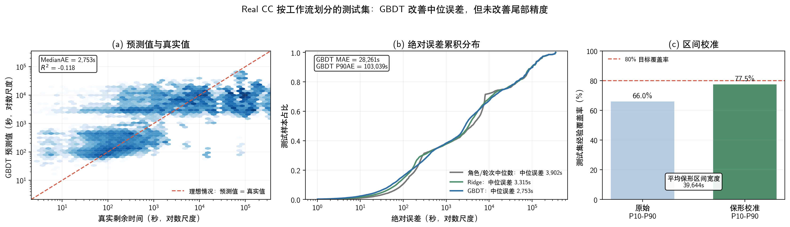

## Alg. 2：Slack Coverage over Recovery Paths

状态：`sglang-physical-plus-sglsim-recompute-hybrid-preliminary`

数据：`data/measured/fig_alg2_slack_coverage.csv`

L1 Backup 与 L2 Backup 使用 SGLang CUDA movement physical anchors；
Recompute 使用当前 SGLSim coefficient model。中图对每条 retry path 应用精确的
$[R-\sigma]_+$ 变换。4,096-token case 中 L1/L2/Recompute retry 分别为
4.58/31.71/48.24ms；该图足以证明 L1 Backup 的低延迟价值，但不是 strict-final
end-to-end failure evidence。

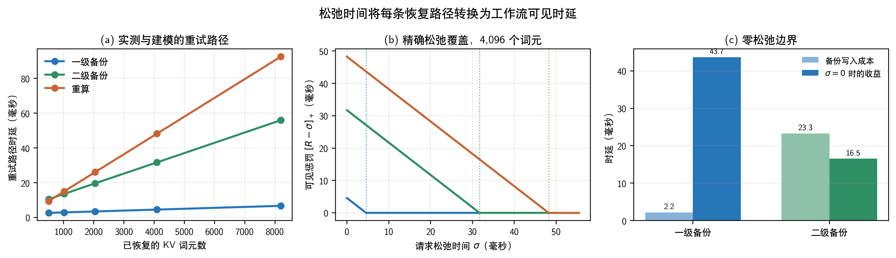

## Alg. 3：Per-Node L1 Backup Alpha

状态：`sglsim-dp8-measured-load-headroom-preliminary`

数据：`data/measured/fig_alg3_per_node_alpha.csv`

该图从 DP8 high-load/high-risk run 的请求存活区间重建每个执行节点的
峰值正常 L1 服务负载，不读取备份优先级、放置结果或 replica demand。
额外保留 5% 安全余量时，负载导出的 $\alpha_n$ 为 79.2%--89.2%；
逐节点配置比统一安全比例多提供 4.0% 的备份容量。它是 motivating replay，
strict-final 仍需真实 per-node actuation sweep。
该图只覆盖正常负载安全上限；完整算法 3 还会读取算法 2 的上一窗口影子需求。
该图不包含 L2 Host 负载，因此不作为 $\beta_n$ 的证据。

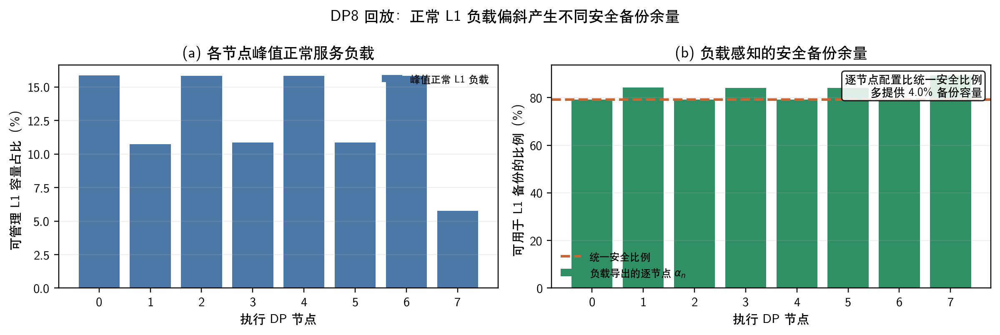

## System Overview

状态：`design-ready`

## Real Trace Motivation：KV Reuse Scope

状态：`real-trace-derived-completed-source-prefix`

数据：`data/measured/fig_real_trace_kv_reuse_scope.csv`

该图直接分析 CC/Weka raw trace 的有序 `hash_ids`。每个请求的输入 KV 被互斥归因到 same-agent history、cross-agent-only incremental reuse 或 new KV；只有在 target 开始前已经完成的 source request 才可参与匹配。它证明全局 input KV token 中 97.90% 可归因于同一 agent 历史，而跨 agent 相对同-agent 历史新增的可复用部分仅 0.37%。subagent first turn 的跨 agent 继承是明确展示的局部例外。该图不模拟路由、驻留和 eviction。

## Real Trace Motivation：Context Size vs Backup Value

状态：`real-trace-derived-agent-lifetime`

数据：`data/measured/fig_real_trace_context_value.csv`

该图直接绘制 1,697 个 completed subagent 的平均请求 context length 与总执行时间，每个点对应一个 subagent。Context length 定义为该 subagent 所有请求 input length 的平均值；它与总执行时间的 Spearman 相关性为 0.29。该结果支持“context size 本身不能可靠预测 agent 生命周期”的 Motivation，但不等价于已经测得 workflow critical path 或 failure savings。

## Motivation 图 1：Main vs Subagent Failure

状态：`sglsim-agentic-online-measured-dp8`

数据：`data/measured/fig_motivation_agent_failure_impact.csv`

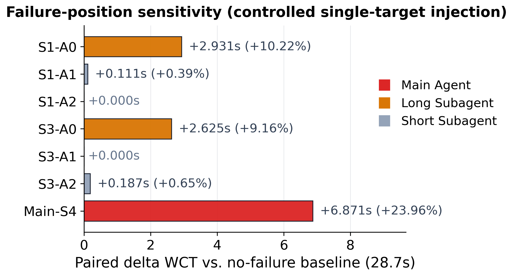

## Motivation Criticality CI

状态：`sglsim-dp8-profile-workflow-ci`

数据：`data/measured/fig_motivation_criticality_ci.csv`

该图从 DP8 motivation profile 的 8 个 workflow group 派生，按 workflow-level mean 计算 95% CI。它证明 Long Critical fan-out agent 在 output token 和 latency 暴露上稳定高于 Non-Critical fan-out agent；failure replay 的跨 seed / real-trace-derived 证据由下一张图补上。

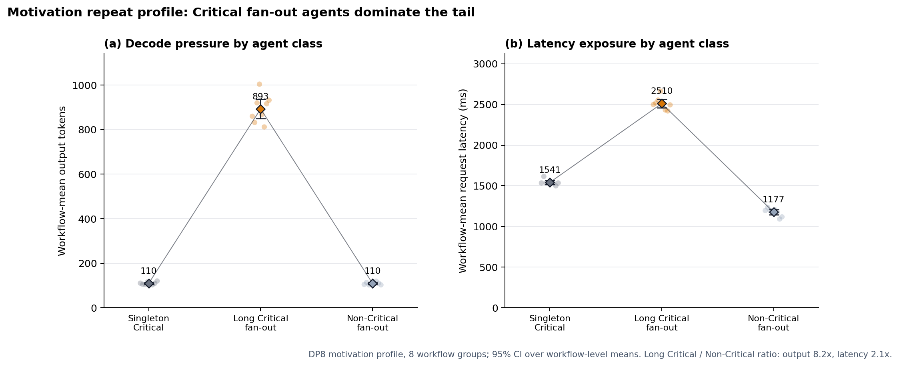

## Motivation Failure Replay Repeats

状态：`sglsim-agentic-online-repeat-plus-real-trace`

数据：`data/measured/fig_motivation_failure_replay_repeats.csv`

该图左侧使用 DP8 100K-context staged workload 的 3 个 seed、每类 2 个 target position，按 same-seed baseline 绘制 paired WCT delta 曲线；右侧使用 Claude Code real trace 的 205 个 candidate failure position，绘制 candidate failover overhead 的 ECDF 分布。

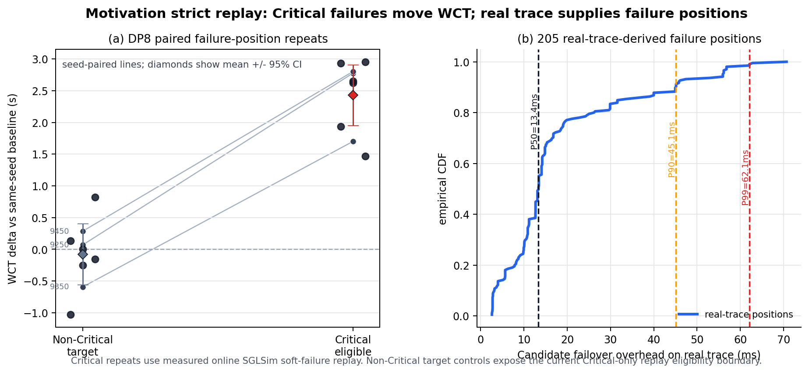

## Backup Policy：L2 Backup vs L1 Backup

状态：`sglsim-agentic-online-policy-matrix`

数据：`data/measured/fig_backup_policy_comparison.csv`

该图来自 12 个 policy run 目录、28 个 measured trial，覆盖 lite / stress /
100K 三档负载与 hard-restart / soft 两类 failure timing。左图给出
per-workflow normalized WCT 的 ECDF，右图给出 per-replay recovery overhead 的 ECDF，用曲线保留 tail behavior。

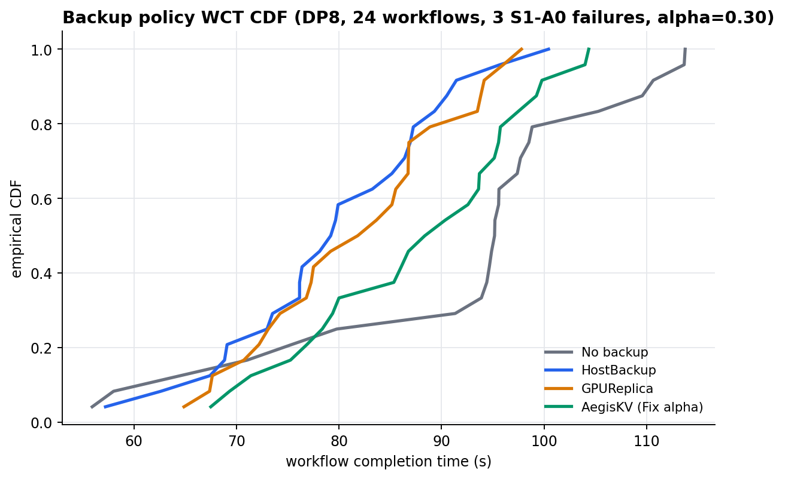

配套内部分析图使用同一组四个 `trial_000`，进一步展示 WCT 分位数、实际恢复与
重计算 token、三次 failure replay 开销，以及按相同 workflow ID 计算的 paired WCT
差值。该图明确标记为旧版固定 $\alpha=0.30$ 的单 seed/单 trial 诊断，不代表当前动态
$\alpha/\beta$ 控制器。

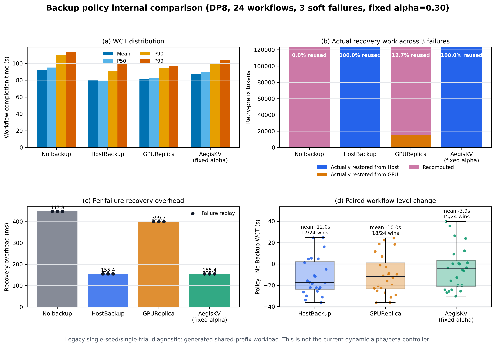

## Failure Scaling Theory

状态：`analytic-projection-not-measured`

数据：`data/analytic/fig_failure_scaling_theory.csv`、
`data/analytic/fig_failure_scaling_theory_assumptions.csv`

该图使用独立 Poisson rank failure 与线性恢复服务成本模型，分析 DP 规模扩大后的故障
暴露、128K KV 的单次恢复成本、集群每日期望恢复工作，以及不同 L1/L2 实际可恢复
覆盖率下的理论加速区域。$\phi_1,\phi_2$ 是实际可恢复覆盖率，不等于容量控制变量
$\alpha,\beta$。该图是理论敏感性分析，不作为 measured performance result。

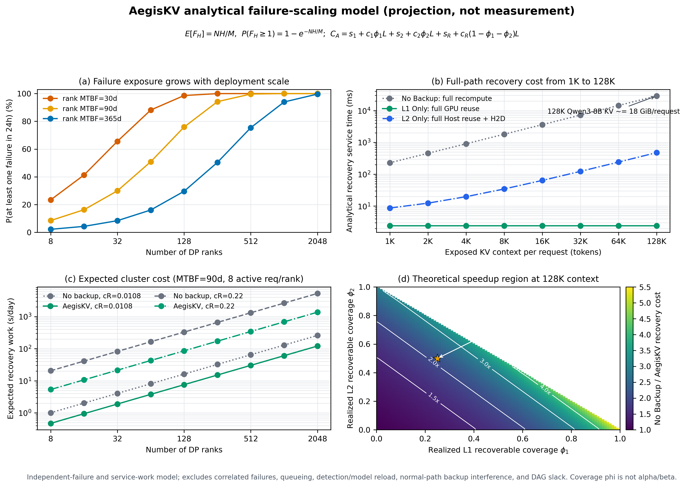

为便于查看四联图中的 (b)，下面单独展开 1K--1M 的三种恢复路径，并比较全部部署在
A100 80GB 上的 Qwen3-8B、Qwen3-32B 和 Qwen3-235B-A22B。三个部署分别采用
TP4/PP2、TP4/PP2 和 TP8/EP8/PP4；每个 8K Prefill chunk 均直接查询
AIConfigurator 的 A100 SILICON 数据，不再使用人为 `ms/token` 重计算惩罚。

No Backup 对完整 context 执行 Prefill。L1/L2 均受当前 SGLSim 的逐 rank 容量限制：
$C_{L1}=176{,}085$、$C_{L2}=352{,}170$、$\alpha=0.25$、$\beta=0.50$，
因此分别最多复用 43.8K 和 175.9K token；超出部分继续由 AIConfigurator 预测
Prefill。L2 H2D 使用配置中的 64 GB/s Host-to-device 带宽与逐 rank KV shard。

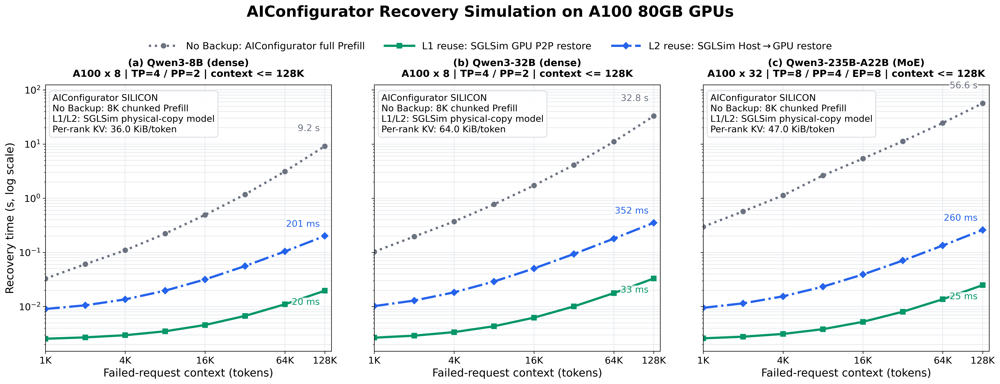

## DP64 Failure Projection on Real CC

状态：`analytic-monte-carlo-projection-not-measured`

数据：`data/analytic/fig_dp64_failure_projection_availability.csv`、
`data/analytic/fig_dp64_failure_projection_workflow_samples.csv`、
`data/analytic/fig_dp64_failure_projection_summary.csv`、
`data/analytic/fig_dp64_failure_projection_assumptions.csv`

该图将用户提供的 64-GPU availability 图数字化，并校准到图中标注的平均 58.07
张可用 GPU。在 24 个 Real CC workflow 上随机放置 128 个起始相位，共形成 3,072
个 paired projection。AegisKV 固定 $\alpha=0.25,\beta=0.50$；容量按当前
SGLSim A100-80GB profile 的 L1/L2 token budget，并假设每个故障 rank 的 8 个活跃
请求公平分摊备份空间。CDF、正常/重试请求比例和 retry-token 恢复来源均为预测，
不是 DP64 实测结果。

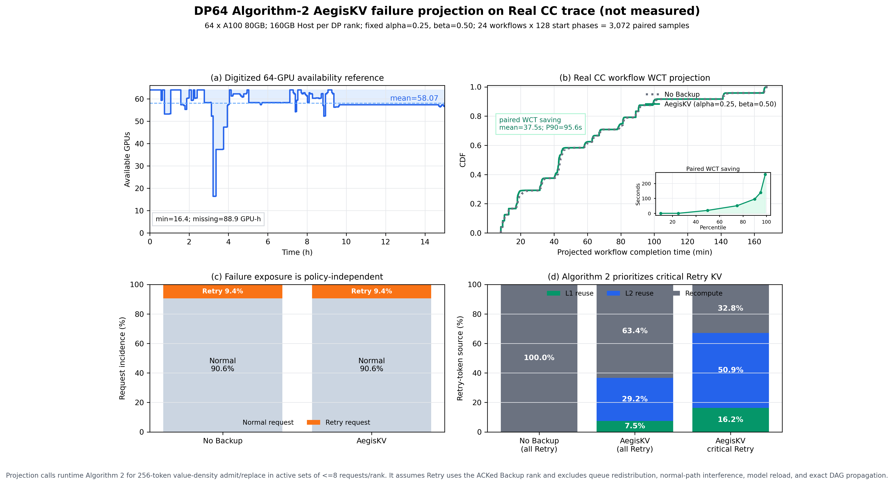

## L1 Alpha Tradeoff

状态：`sglsim-measured-calibrated-convex-tradeoff`

数据：`data/measured/fig_gpu_replica_alpha_tradeoff.csv`

Raw measured 校准点：`data/measured/fig_gpu_replica_alpha_tradeoff_raw_measured.csv`

左图展示并发压力对 $\alpha^*$ 的影响：并发越高，正常 serving 的 inference KV pressure 越强，最优 L1 Backup HBM fraction 左移。右图展示 failure pressure 对 $\alpha^*$ 的影响：受控 failure 注入次数越高，更多 Critical KV 值得保留在 L1 Backup 中，校准后的 $\alpha^*$ 右移；空心点为 raw measured best alpha。

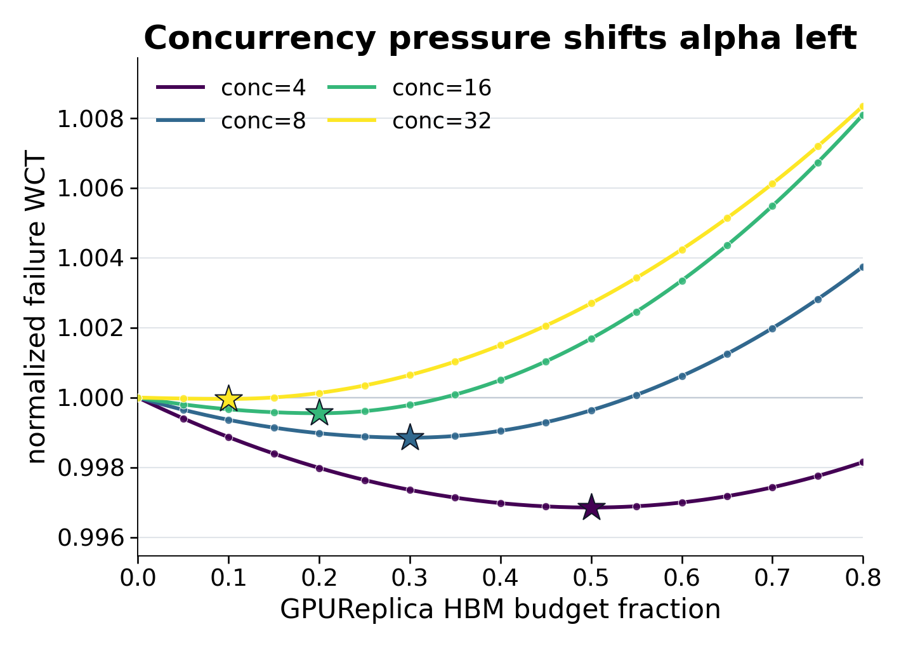

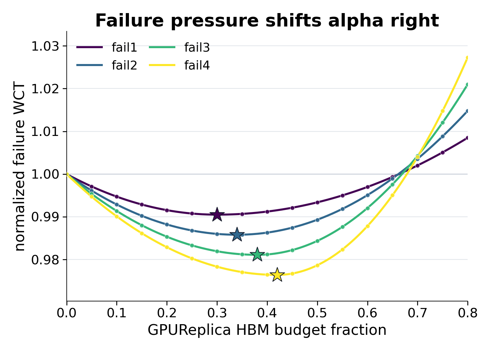

## Online Alpha：历史策略证据

状态：`sglsim-agentic-online-alpha-sweep`

数据：`data/measured/fig_online_alpha_adaptation.csv`

Real trace 派生数据：`data/measured/fig_online_alpha_adaptation_claude_trace_dp8.csv`

该图保留的是旧 policy-table/MDP 命名下的实验 provenance。当前论文使用
SLO-constrained alpha lookup，不以这张图证明 MDP。

## Ablation Matrix

状态：`sglsim-agentic-online-ablation-sweep`

数据：`data/measured/fig_ablation.csv`

该图来自 11 个 runtime/component ablation 变体、33 次 online SGLSim trial。当前 workload 下 WCT 差异仍小，但 static alpha、size-only backup、no peer locality 和 no marginal accounting 已进入同一条 serving path；右侧 recovery action 分布用于说明不同组件开关确实改变了 recovery path。

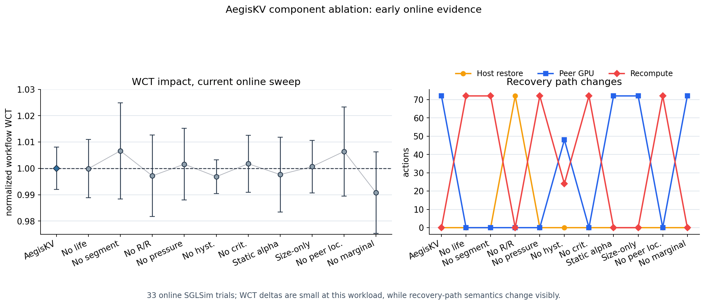

## Real Trace Characterization：Claude Code Trace

状态：`sglsim-real-trace-characterization`

数据：`data/measured/fig_real_trace_characterization.csv`

该图直接从 serving 后的 `request_details.csv` 派生，用于说明当前 Claude Code trace workload 的 workflow/request/token 分布和 AegisKV token exposure；它不单独证明跨 source 泛化。

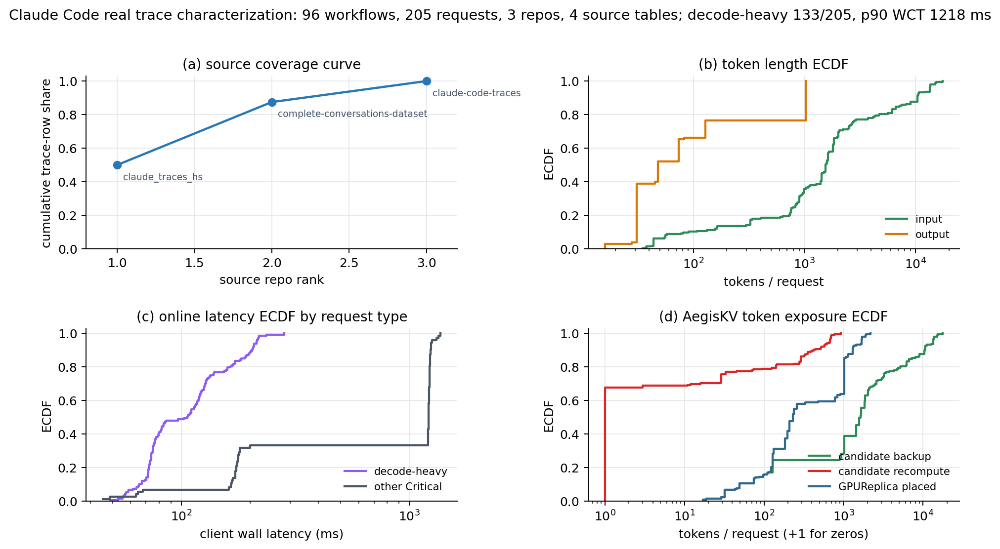

## SGLang/SGLSim Accuracy

状态：`sglang-sglsim-synthesis-parity`

数据：`data/measured/fig_sglang_sglsim_accuracy.csv`

该表用于记录 no-HiCache fa3 base-serving parity：8 个指标全部在 10% 以内，当前最大相对误差为 7.12%。

## Real-System Recovery Calibration

状态：`sglang-sglsim-physical-recovery-calibration`

数据：`data/measured/fig_real_system_recovery_calibration.csv`

该图把 SGLang 物理 Host H2D / peer P2P copy 锚点、SGLSim recompute coefficient、strict recovery matrix，以及 online SGLSim physical-copy timing smoke 放到同一张图中。当前 smoke 已使用 `physical_recovery_path_csv` timing source，但 data plane 仍是 `metadata_materialization`，因此它是校准证据，不是 strict-final live tensor-copy policy run。

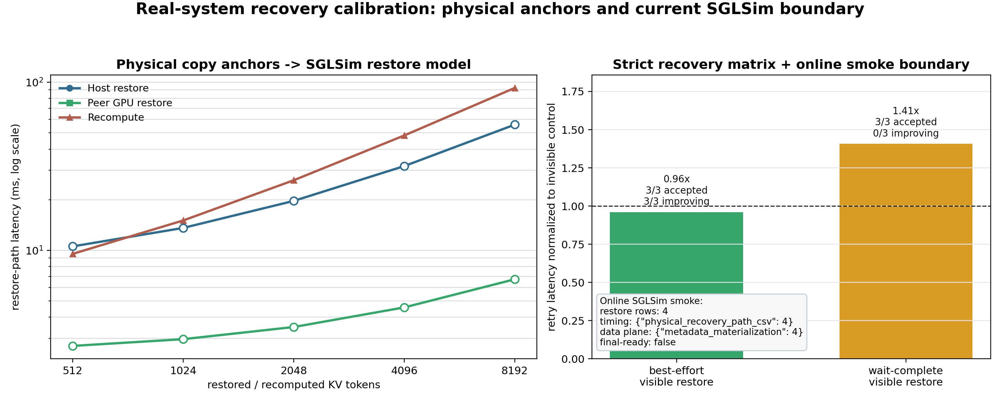
