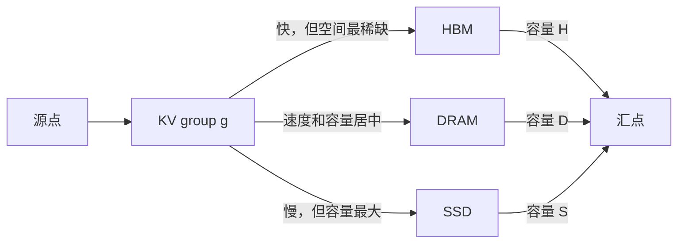
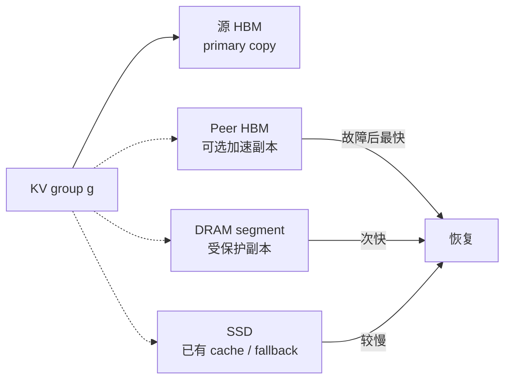

# Multi-Tier Rental Landlord：算法脉络与 AegisKV 扩展

## 1. 名称说明

**Multi-Tier Rental Landlord 并不是已有文献中公认的单一经典算法。** 更准确地说，它是 AegisKV 将以下三条研究脉络组合后形成的设计方向：

1. 在线 paging 与 cache replacement；
2. GreedyDual-Size / Landlord 的 credit 机制；
3. Rental Caching 的驻留成本，以及多层缓存的 placement 问题。

因此，论文不应声称“采用了经典的 Multi-Tier Rental Landlord”，而应表述为：AegisKV 在 Landlord 和 Rental Caching 的基础上，面向多层、故障感知的 KV 保护进行了扩展。

## 2. 发展历史

### 2.1 经典 Paging：相同大小和相同 Miss Cost

早期 paging 模型通常假设所有 page 大小相同、cache miss 的代价相同，目标是最小化 miss 次数。LRU 和 FIFO 是典型的在线策略；如果预先知道完整访问序列，Belady OPT 可以淘汰下一次访问最晚的 page。

这一模型无法准确处理真实缓存中的两个差异：对象大小不同，以及重新加载对象的代价不同。例如，一个体积很大的低价值对象未必应该挤走多个体积较小但重新加载代价很高的对象。

### 2.2 GreedyDual：引入不同的加载代价

GreedyDual 为缓存对象维护一个优先级或 credit。对象被访问时，根据重新加载代价获得 credit；需要回收容量时，全局降低 credit，并淘汰最先归零的对象。

与 LRU 只依据 recency 不同，GreedyDual 开始直接考虑 cache miss 的经济代价。其分析采用 primal-dual 思想：对象的 credit 表示保留对象的价值，全局降低 credit 相当于提高 cache 容量约束的 dual price。

### 2.3 GreedyDual-Size：同时考虑大小和加载代价

1997 年，Cao 和 Irani 提出 GreedyDual-Size，将对象的大小加入 GreedyDual。对象 $f$ 被访问时，其优先级设置为

$$
H(f)=L+\frac{c(f)}{\operatorname{size}(f)},
$$

其中 $c(f)$ 是重新加载对象的代价，$\operatorname{size}(f)$ 是对象大小，$L$ 是最近一次 eviction 更新的全局 inflation value。

因此，算法比较的是单位缓存容量能够避免的 miss cost。原始工作还给出了基于优先队列的高效实现，使 priority update 和 eviction 通常可以在 $O(\log n)$ 时间内完成。

参考文献：[Cao and Irani, *Cost-Aware WWW Proxy Caching Algorithms*, USENIX 1997](https://www.usenix.org/conference/usits-97/cost-aware-www-proxy-caching-algorithms)。

### 2.4 Landlord：统一的 Credit/Rent 表述

Young 在 SODA 1998 提出 Landlord，随后发表于 Algorithmica 2002。Landlord 与 GreedyDual-Size 是独立得到的相近算法，但 Landlord 给出了更一般、也更适合竞争分析的 credit 表述。

对于缓存中的文件 $f$，Landlord 维护

$$
0\leq \operatorname{credit}(f)\leq c(f),
$$

其中 $c(f)$ 是重新获取文件的代价。当新文件 $g$ 需要进入而容量不足时，算法计算

$$
\Delta
=
\min_{f\in C}
\frac{\operatorname{credit}(f)}{\operatorname{size}(f)},
$$

然后对缓存中的每个文件收取与其大小成比例的“租金”：

$$
\operatorname{credit}(f)
\leftarrow
\operatorname{credit}(f)
-
\Delta\operatorname{size}(f).
$$

credit 归零的文件被淘汰。新文件进入后，其 credit 初始化为重新获取代价：

$$
\operatorname{credit}(g)=c(g).
$$

文件命中时，可以在当前 credit 与 $c(g)$ 之间选择新的 credit。不同的更新方式能够覆盖 FIFO、LRU 和 GreedyDual-Size 风格的策略。

这里的“rent”主要是 eviction 过程中对 credit 的统一扣减，是一种 primal-dual 更新机制，并不表示对象每经过一个物理时间单位都必须支付真实费用。

参考文献：[Young, *On-Line File Caching*, SODA 1998 / Algorithmica 2002](https://www.cs.ucr.edu/~neal/publication/Young98Online.pdf)。

### 2.5 Rental Caching：真正引入持续驻留成本

Khare 和 Young 在 2012 年研究 Rental Caching。该模型规定：对象每在 cache 中停留一个时间单位，就产生租金 $\lambda$。优化目标变为

$$
\min
\left(
\text{retrieval cost}
+
\text{accumulated rental cost}
\right).
$$

Rental Caching 不仅需要在容量不足时决定淘汰谁，还需要在 cache 尚有空间时判断一个对象是否值得继续驻留。该工作使用 online covering 框架设计在线算法，并分析其 competitive bound。

因此，Landlord 和 Rental Caching 中的 rent 含义需要区分：

- Landlord 的 rent 是容量不足时的 credit decrement；
- Rental Caching 的 rent 是对象随驻留时间持续产生的实际 holding cost。

参考文献：[Khare and Young, *Caching with Rental Cost and Zapping*, 2012](https://arxiv.org/abs/1208.2724)。

### 2.6 Multi-Tier Caching：独立发展的 Placement 问题

多层缓存研究关注对象应放在哪一层或哪个缓存节点，例如容量较小但速度更快的上层 cache，以及容量较大但访问更慢的下层 cache。它需要同时考虑节点容量、访问距离、传输成本和副本数量。

Hierarchical Cooperative Caching 的早期工作已经在特定假设下将精确 placement 规约为 min-cost flow，同时指出精确算法未必适合大规模在线执行。这条研究路线主要解决静态或周期性的 placement，并不是 Landlord 的自然多层版本。

参考文献：[Korupolu, Plaxton, and Rajaraman, *Placement Algorithms for Hierarchical Cooperative Caching*, Journal of Algorithms 2001](https://doi.org/10.1006/jagm.2000.1129)。

### 2.7 Hierarchical Cooperative Caching 如何规约为 MCF

上一节提到，该工作可以用 MCF（最小费用流）求静态最优放置方案。其直觉并不复杂：物理 caches 按距离组成一棵树，上层表示较大的网络区域，最底层是实际存放对象的 cache。论文假设对象大小相同，并且已经知道各处对每个对象的访问频率。

如果某个区域内还没有对象 $o$，请求必须到区域外读取；在该区域放入第一份 $o$ 后，可以节省一部分访问时间。论文把这部分收益记为

$$
\operatorname{value}
=
\text{访问频率}
\times
\text{节省的访问时间}.
$$

用 KV cache 的 HBM、DRAM 和 SSD 三层结构来理解，可以先看一个简化例子。每个 KV group 产生一单位流，并在 HBM、DRAM 和 SSD 中选择一个位置。三层的容量对应流网络中的边容量；放置费用同时反映访问或恢复时间以及占用稀缺资源的代价。

| KV 管理问题 | 流网络中的表示 |
|---|---|
| 一个 KV group | 一单位流 |
| KV 放入 HBM、DRAM 或 SSD | 流选择相应的放置边 |
| 每一层可保存多少 KV | 该层通向汇点的边容量 |
| 某个 KV 放在该层的代价 | KV 到该层的边费用 |
| 多个 KV 争用同一层 | 它们共享该层的容量边 |



例如，KV group $g$ 放在层 $q$ 的边费用可以写成

$$
c(g,q)
=
\text{预计访问或恢复时间}
+
\text{该层的空间代价}.
$$

HBM 恢复最快，但容量边最紧，空间代价也最高；SSD 容量较大，但恢复时间更长；DRAM 位于两者之间。所有 KV groups 一起进入网络后，MCF 在各层容量内最小化总费用，因此紧急或恢复代价高的 KV 会优先占用 HBM，其他 KV 则进入 DRAM 或 SSD。空间不足时，一些原本位于 HBM 的 KV 会被重新分配到 DRAM 或 SSD，这在物理系统中对应 demotion 或 eviction。

原始 Hierarchical Cooperative Caching 允许同一对象存在多个副本，因此还使用“容量 1 的负费用边”表示某个网络区域中第一份副本带来的收益，并使用“零费用边”允许后续副本通过而不重复计算收益。上图只用于直观说明 HBM、DRAM 和 SSD 与 MCF 的基本映射。

MCF 的目标是寻找总费用最低的流，因此它会在满足 HBM、DRAM 和 SSD 容量限制的同时，选择总代价最低的放置方案。若所有请求都未命中时的总代价是常数 $C_0$，则

$$
\operatorname{flowCost}
=
\operatorname{placementCost}-C_0.
$$

$C_0$ 对所有方案都相同，所以最小化 flow cost 就等价于最小化 placement cost。这个规约依赖相同大小的对象、静态访问频率和树状网络；AegisKV 的动态 Slack、连续 KV prefix 以及 DRAM 与 Peer HBM 的联合占用不能直接照搬这一模型。

## 3. 三条脉络的关系

整体发展关系可以概括为：

```text
Paging
  -> GreedyDual
  -> GreedyDual-Size / Landlord
  -> Rental Caching

Hierarchical / Multi-Tier Cache Placement
  -> capacity- and topology-aware placement

两条路线在 AegisKV 中结合
  -> Slack-aware multi-tier KV protection
```

各类方法解决的问题并不相同：

| 方法 | 主要回答的问题 | 主要限制 |
|---|---|---|
| LRU/FIFO | 容量不足时淘汰谁 | 不区分大小和恢复代价 |
| GreedyDual-Size/Landlord | 不同大小和 miss cost 下淘汰谁 | 原始模型是单个 cache，价值通常固定 |
| Rental Caching | 对象值得驻留多长时间 | 原始模型不处理多层 placement 与故障域 |
| MCF Placement | 静态 snapshot 中对象放在哪个节点 | 动态变化时需要重求解；完整多资源问题未必仍是普通 MCF |
| AegisKV 扩展 | KV 何时下沉、放在哪一层、何时降级或淘汰 | 需要为动态 Slack 和多资源耦合重新建立理论边界 |

## 4. AegisKV 的 Multi-Tier Rental Landlord

AegisKV 不能直接把上一节的 MCF 当作在线 KV 管理算法，原因有两点：

1. **目标不同。** Hierarchical Cooperative Caching 根据访问频率最小化平均访问代价；AegisKV 关心故障使 workflow completion time（WCT）增加多少，因此 KV 的价值由当前 Slack 和各条恢复路径决定，而不是由访问频率决定。
2. **运行方式不同。** MCF 求解一个对象集合、价值和容量均已知的静态放置问题；AegisKV 中 KV 持续产生，Slack 随 workflow 运行而更新，HBM、DRAM 和传输压力也不断变化，需要在线决定何时建立、保留、降级或删除副本。

因此，MCF 更适合作为固定时刻的离线最优参照。AegisKV 的在线 Algorithm 2 则从 Landlord 出发，提出 **Multi-Tier Rental Landlord**。

### 4.1 相对于 Landlord 的变化

| Landlord | AegisKV 的 Multi-Tier Rental Landlord |
|---|---|
| 管理一个 cache | 管理 Peer HBM 和多个 DRAM segments，同时把已有 SSD cache 计入恢复路径 |
| 文件只有“在 cache 中”或“不在”两种情况 | 同一个 KV 可以同时在多个 tier 中保存副本 |
| credit 来自固定的文件重新读取代价 | credit 来自当前 Slack 下能够减少的可见恢复时间 |
| 所有对象竞争一个容量 | 每个 tier 和 segment 有独立容量与 rent |
| credit 归零后直接淘汰文件 | 副本可以逐层降级，例如 Peer HBM 降为 DRAM |
| 主要由文件访问和 cache miss 驱动 | 由 KV group 完成、Slack 更新和资源压力驱动 |

Landlord 的基本思想仍然保留：一个副本获得 credit，并为自己占用的资源支付 rent；当 credit 无法继续支付 rent 时，该副本被降级或删除。AegisKV 的改变是让 credit 反映故障恢复价值，并分别对不同存储层收费。

### 4.2 同一个 KV 可以存在于多个 Tier

AegisKV 不是让一个 KV 在 HBM、DRAM 和 SSD 中三选一。正常运行时，KV group $g$ 的 primary copy 位于执行请求的源 HBM；与此同时，它还可能具有 SSD cache、受保护的 DRAM copy，以及 Peer Worker 上的 HBM copy：



源 HBM 中的 primary KV 是当前推理所需的数据，不由 Algorithm 2 当作冗余副本淘汰。Algorithm 2 管理的是其余恢复副本。按照当前设计，Peer HBM 是 DRAM 基础副本之上的加速副本；因此删除 Peer-HBM copy 时，DRAM copy 仍然存在，不需要在淘汰时再执行一次 HBM-to-DRAM copy。SSD 可以作为已有的更慢 fallback，与 DRAM 和 Peer HBM 同时存在。

这意味着 credit 不能按“KV 是否被缓存”计算，而要按**每个副本相对于其余副本增加了多少恢复价值**计算。设 $P$ 是 KV group $g$ 已有的其他可用副本，$R_g(P)$ 是故障后使用这些副本的预计恢复时间，$s_g(t)$ 是当前 Slack。其不能被 Slack 隐藏的恢复时间为

$$
L_g(P,t)=\left[R_g(P)-s_g(t)\right]^+.
$$

在位置 $q$ 增加一个副本的边际价值为

$$
\Delta V_g(q\mid P,t)
=
L_g(P,t)-L_g(P\cup\{q\},t).
$$

例如，SSD 已经存在时，DRAM copy 的 credit 只计算“DRAM 相对 SSD 减少的可见恢复时间”；DRAM 已经存在时，Peer-HBM copy 只计算“Peer HBM 相对 DRAM 减少的可见恢复时间”。这样多个 tier 同时保存同一个 KV 时，不会重复计算保护价值。

### 4.3 在线 Credit 与 Rent

每个受管理副本分别维护 credit。设副本大小为 $b_g$，它在位置 $q$ 的初始 credit 是上一节定义的边际恢复价值，再扣除建立该副本的传输代价。算法比较单位字节 credit；每个 Peer Worker 和 DRAM segment 分别维护自己的 rent。AegisKV 不需要按物理时间持续扫描全部 KV：只有新副本无法放入某层时，才提高该层 rent，并从最低 credit density 的副本开始降级，直到释放足够空间。SSD 仍可由底层 cache policy 管理，但它是否存在会改变 DRAM 和 Peer-HBM 的边际价值。

#### Slack、预计执行时间与公平性

Slack 已经由预计剩余执行时间和 workflow 依赖关系计算得到，因此不能再把预计执行时间直接加到恢复收益中，否则同一因素会被计算两次。两者在 Algorithm 2 中承担不同作用：

- Slack 决定一个副本能够减少多少故障可见 WCT，即核心 credit；
- 预计剩余执行时间用于计算相对紧迫度：

$$
\ell_g(t)=\frac{s_g(t)}{\max(\widehat T_g(t),\epsilon)},
$$

其中 $\widehat T_g(t)$ 是所在 workflow 的预计剩余执行时间，$\epsilon$ 是防止分母为零的很小正数。$\ell_g(t)$ 越小，表示可用 Slack 相对于剩余工作越少；当两个副本的单位字节 credit 接近时，优先保护 $\ell_g(t)$ 更小的副本。

公平性不改变上述 WCT 收益，而作为最后一道约束：Controller 为每个 workflow 或 tenant 维护受保护字节的软配额；超过配额的 workflow 支付更高 rent，长期未获得保护的 workflow 通过 aging 提高优先级。这样，大 KV 或长 workflow 不能长期占满 Peer HBM 和 DRAM，同时系统仍首先保护真正能够减少故障 WCT 的 KV。

#### 副本何时建立、降级和删除

算法在 KV group 完成、Slack 更新和资源受压时重新计算受影响副本的 credit。不同 tier 的副本独立计价：Peer-HBM credit 只表示它相对于 DRAM 能额外减少的恢复时间；DRAM credit 只表示它相对于 SSD 或重计算能额外减少的恢复时间。因此，副本并不一定只能存在于一个 tier。

当下一级副本已经存在时，规则很简单：上一级副本仍有正的边际 credit 就可以与下一级同时保留；其 credit 归零且该层容量受压时，只删除上一级副本。例如：

```text
Peer HBM + DRAM + SSD
        -- Peer-HBM credit 归零 --> DRAM + SSD
        -- DRAM credit 归零 -----> SSD
```

当下一级副本尚不存在时，不能等上一级 credit 归零后才开始迁移，因为复制本身需要时间。AegisKV 使用两个阈值：若下一级副本自身仍有正收益，并且按当前 rent 估计上一级将在一次降级复制完成前耗尽 credit，就先启动复制；只有下一级写入完成、且 KV Directory 已提交新副本后，才允许删除上一级副本。复制期间两级同时存在是必要的过渡状态，而不是重复放置错误。

反向 promotion 使用滞回阈值：只有 Slack 缩小后，快速副本的新增 credit 明显高于 copy cost 和当前 rent 时才提升；降级阈值低于提升阈值。这样可以避免 Slack 小幅波动导致 HBM 与 DRAM 之间反复搬迁。对于多个 DRAM segments，Controller 只在满足故障域约束的候选中，选择“单位字节边际 credit 减去 copy cost 和 segment rent”最高的位置。

由此，down-tier admission、DRAM segment placement、Peer-HBM promotion 和 eviction 共用同一个 credit/rent 机制；区别只在于候选层的恢复收益、传输成本、容量价格和故障域约束。

### 4.4 与现有 KV Offload 框架结合

AegisKV 是现有 offload 数据通路之上的策略层，不重新实现 page allocator、传输引擎或普通 cache replacement。现有系统负责发现可复制的 KV block、执行异步传输并维护物理副本；AegisKV 只补充 workflow 信息，并决定哪些 block 获得保护、放到哪里以及何时解除保护。

根据当前公开接口和本地 pinned source，现有 offload 机制主要根据 block 完成、访问次数、cache hit、容量压力或请求级上限工作，没有看到将 tool-call 阶段及其 workflow 关键路径直接作为 cache policy 输入的机制。因此，tool-call 边界由 Application/Router 识别：模型返回 tool call 后，Application 立即预测 tool 执行和后续阶段的剩余时间，更新 Slack，并向 Aegis Controller 发送轻量更新，使传输能够与 tool 执行重叠；下一次请求再携带同一 workflow id、Slack 和预计剩余时间进行版本校验。这个过程不需要额外的 ticket 抽象。Controller 把这些信息转换为上述 credit，底层框架仍按原有方式执行数据移动。

| 现有框架提供的机制 | AegisKV 的最小改动 |
|---|---|
| [vLLM KV Offloading](https://docs.vllm.ai/en/latest/features/kv_offloading_usage/) 将完成的 prefix blocks 下沉到 CPU，并可配置二级存储；请求还能用 `max_offload_tokens` 限制可下沉的 prefix，且默认跳过 decode blocks | prefix 粒度足够时，Controller 直接设置请求级上限；tool-call 回合中新生成的 KV 需要允许 decode offload。需要任意 block 选择或 Peer HBM 时，通过自定义 OffloadingSpec/policy hook 接入，connector 继续执行实际传输 |
| [SGLang HiCache](https://github.com/sgl-project/sglang/blob/main/docs_new/docs/advanced_features/hicache_design.mdx) 提供 write-through、selective write-through 和 write-back，并在 L1/L2/L3 之间执行 backup、load 和 eviction | 保留 HiCache 的 radix/page 管理与传输，通过 policy hook 把固定命中阈值改为 Slack-credit admission，并将 credit 映射为 cache priority；实现时必须保持连续 prefix 的 backup 约束 |
| [Mooncake Store](https://github.com/kvcache-ai/Mooncake/blob/main/docs/source/deployment/mooncake-store-deployment-guide.md) 由 Master 维护副本位置，支持内存淘汰、SSD offload 和命中后的 promotion | Aegis Controller 读取同一 KV Directory，并通过一个窄的 policy hook 设置保护、目标 segment 和优先级；Store 的队列、租约、复制和 SSD 后端继续负责实际执行 |

当 workflow 元数据缺失时，系统退回框架原有 policy；当元数据存在时，AegisKV 覆盖的是 admission 和 priority，而不是绕过底层的容量与一致性检查。这样，AegisKV 的创新点不是再次提出多级 offload，而是用同一个在线 Slack-credit 信号协调正常期的多副本 KV 管理，并直接服务于故障后的 WCT 降低。

## 5. 理论边界

原始 Landlord 和 Rental Caching 的 competitive guarantee 不能直接应用到完整 AegisKV，因为后者还包含：

- 随 workflow 执行动态变化的 Slack 和对象价值；
- 多个异构 DRAM segments；
- DRAM 与 Peer HBM 的嵌套容量；
- failure-domain 和恢复 target 兼容性；
- 连续 KV prefix 约束；
- promotion、demotion 和 transfer bandwidth；
- 多个故障请求共享恢复资源时的排队耦合。

为了保持理论声明准确，论文可以首先分析一个受限模型，例如：单个 DRAM pool、固定大小 KV group、固定 Slack、独立恢复代价。在该模型中证明 credit/rent 更新的 competitive property 或 approximation bound。多 segment、Peer HBM 和动态 Slack 则作为系统算法扩展，并分别给出容量安全、故障域安全和无有害切换等性质。

## 6. 建议的论文表述

不建议写：

> We adopt the classical Multi-Tier Rental Landlord algorithm.

建议写：

> AegisKV extends the primal-dual credit mechanism of Landlord and the time-dependent holding cost of rental caching to multi-tier, failure-aware KV protection. Workflow slack determines the recovery value of each protected KV group, while tier-specific resource prices control DRAM placement, Peer-HBM promotion, and eviction.

这一表述能够清楚区分：Landlord、Rental Caching 和 multi-tier placement 是已有算法基础；用动态 workflow Slack 将它们连接起来并用于故障恢复，是 AegisKV 需要设计和证明的新机制。
