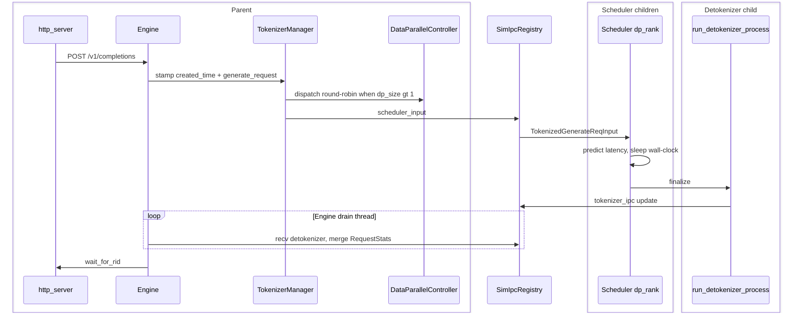

# SGLSim

Metadata-only simulator with SGLang Runtime (`srt`) layout. Familiar `TokenizerManager`, `Scheduler`, `DetokenizerManager`, and HTTP `launch_server` entrypoint.

## Positioning

SGLSim simulates SGLang **online serving** without a GPU. Unlike trace-replay simulators (Vidur / Opal-sim / sglang-simulator are single-process, offline logical-time DES), it launches the **real SGLang process topology** (`Engine` + `DataParallelController` + one `Scheduler` per `dp_rank` + `DetokenizerManager`) behind a **live HTTP server** and is driven by a **real async closed-loop client**; only the GPU forward pass is replaced by a predicted duration (AIConfigurator / heuristic).

Simulation uses **real wall-clock time**: the scheduler `sleep(predicted)` per step. Each subprocess sleeps independently on one shared real timeline, so multi-DP drift emerges naturally.

Offline / logical-clock simulation is **not implemented on main**; see [docs/todo/offline-simulate-design.md](docs/todo/offline-simulate-design.md).

## Architecture

### SRT layout (`python/sglsim/srt/`)

```text
python/sglsim/
  launch_server.py              # aligned with sglang/launch_server.py
  srt/
    server_args.py              # ServerArgs, PortArgs (CLI subset)
    entrypoints/
      engine.py                 # Engine: three-component orchestration
      http_server.py            # FastAPI, SGLang route subset
    managers/
      tokenizer_manager.py      # metadata tokenize + ZMQ send
      detokenizer_manager.py    # decode subprocess + ZMQ reply
      scheduler.py              # scheduling loop (no GPU)
      data_parallel_controller.py  # DP round-robin dispatch (subprocess when dp_size>1)
      schedule_batch.py         # ScheduleBatch, Req, ForwardMode
      schedule_policy.py        # prefill/decode policy (FIFO phase 1)
      io_struct.py              # GenerateReqInput, TokenizedGenerateReqInput subset
      cache_controller.py       # HiCacheController
      tp_worker.py              # stub: rank/tp metadata only
    mem_cache/
      radix_cache.py            # RadixCache
      hiradix_cache.py          # HiRadixCache
      hicache_storage.py        # MockHiCacheStorage (no real L3 I/O)
      common.py                 # KV page metadata helpers
    model_executor/
      model_runner.py           # MockModel + capacity estimate, no torch forward
    utils/
      network.py                # SimIpcRegistry, SimZmqSocket
    distributed/
      parallel_state.py         # stub: tp/dp/pp rank metadata
    simulation/                 # sglsim extension
      types.py                  # SimulationMode, RequestStats
      manager/
        state.py                # StateManager (HiCache bookkeeping)
        config.py               # ConfigManager + sim JSON
        env.py
      pipeline_accounting.py    # Pipeline v2 wall-clock sleep
      forward_slot.py           # CPU overflow budget
    time_predictor/             # AIConfigurator / heuristic
    spec/                       # ModelInfo, AcceleratorInfo
    observability/
      req_time_stats.py         # bridge to RequestStats
```

### Process topology (aligned with SGLang Engine)

Launch order: scheduler subprocess(es) ready -> detokenizer subprocess -> `TokenizerManager` in parent. `dp_size=1` still uses one scheduler subprocess (not an in-process thread). Cross-process IPC: `SimIpcRegistry` (`multiprocessing.Queue` per ZMQ endpoint).



### Simulation time and metrics

The clock is real wall time: the scheduler `sleep(predicted)` for tokenize and each inference/decode step, so `created_time` / `queue_start` / `last_event_time` are real-clock coordinates and parallel DP ranks drift naturally.

**Streaming arrival** (`--streaming-arrival`, required for `launch_server`): requests enqueue on `POST /v1/completions`; scheduler children run event loops; clients block until each request completes. Synthesis benchmark requires `request_rate=inf`; cap in-flight requests with client `max_concurrency`.

Benchmark CSV / run metrics (`last_event_time` starts at `created_time` on register):

| Metric | Source | Meaning |
|--------|--------|---------|
| **TTFT** | `gen_token_latencies[0]` | arrival to first token |
| **TPOT / ITL** | `gen_token_latencies[1:]` | per-output-token intervals |
| **waiting_time** | `queue_end - queue_start` | queue wait |
| **total_latency** | `last_event_time - created_time` | full service span |
| **duration** (run) | `max(last_event_time)` | wall span for throughput |

Throughput: `completed / duration` (token rates likewise).

### HiCache

Hierarchical KV cache (L1 GPU / L2 host / L3 disk) with metadata + predicted transfer timing (`CommunicationTimePredictor`, alpha-beta on platform bandwidth):

- **H2D**: `init_load_back` / `load_back` at prefill when host hit >= `load_back_threshold`.
- **D2H**: `write_backup` on extend/evict per write policy; overlap hides part inside the forward (`consume_backup_overlap`), the remainder at response time.
- **L3**: `prefetch_from_storage` (read) and `write_to_l3` (write).

Write policies (`hicache_write_policy`): `write_through` (every touched node), `write_through_selective` (default, after `write_through_threshold` hits), `write_back` (on L1 evict only). `tp_size > 1` affects inference prediction only; HiCache control flow is single-rank.

## Quick Start

```bash
uv sync --extra test --extra server --extra benchmark
```

### launch_server

```bash
uv run --extra server python -m sglsim.launch_server \
  --model-path mock-model \
  --streaming-arrival \
  --host 127.0.0.1 --port 30000
```

Synthesis benchmark: `benchmark/synthesis_requests/run.py`. Sim JSON (`--sim-config-path`) may tune `predictor.database_mode`, scale factors, and `scheduler.backend_version` (default `0.5.10`).

## Supported

- SRT module layout aligned with SGLang
- Simulated ZMQ IPC (`SimZmqSocket`)
- STREAMING arrival, wall-clock simulation
- HiRadixCache / HiCacheController metadata
- TTFT / TPOT / ITL benchmark table output

## Not Supported

- Real GPU inference, CUDA, NCCL
- Full OpenAI API surface

Fault tolerance simulation lives on the `fault-tolerance` branch (offline strategies, GPU failure injection, multi-agent benchmarks).

Docs: [docs/README.md](docs/README.md).

## Reference

- SGLang
- Mini-sglang
- Sglang-simulator
- Vidur
- Opal-sim
- AIconfigurator
