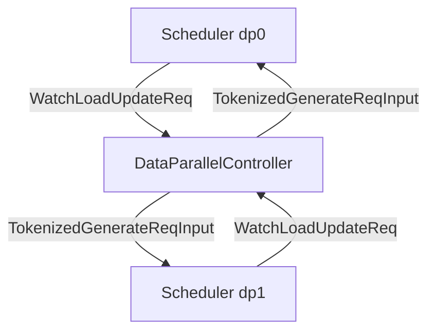

# Cache-Aware Scheduling and DP Load Balance Design

**Status:** Draft | **Phase:** P1 not started

## Related plans

- [trace-calibration-design.md](trace-calibration-design.md) — acceptance for `lpm` + `dp=2`
- [communication-time-prediction-design.md](communication-time-prediction-design.md) — no direct dependency

## Goal

Reduce scheduling divergence from SGLang on **prefix-heavy** workloads by porting:

- Cache-aware policies **LPM** (longest prefix match) and **DFS-weight**
- DP load balance **total_requests** and **total_tokens** (aligned with `sglang.srt.managers.data_parallel_controller`)

## Non-goals

- `routing-key`, `lof`, `random`, `follow_bootstrap_room`
- `enable_dp_attention` and DP-attention scheduler topology
- `PrefillDelayer`, priority scheduling, NSA/CP-specific policy branches
- Changing AIConfigurator inference latency (scheduling only)

## Current state

| Component | File | Today |
|-----------|------|-------|
| Schedule policy | [schedule_policy.py](../../python/sglsim/srt/managers/schedule_policy.py) | Only `fcfs` |
| Config field | [scheduler_config.py](../../python/sglsim/srt/simulation/manager/scheduler_config.py) `schedule_policy` | Default `fcfs`, wired in scheduler but policy ignores cache |
| Scheduler hook | [scheduler.py](../../python/sglsim/srt/managers/scheduler.py) ~L164 | `policy.calc_priority` before prefill batch |
| DP controller | [data_parallel_controller.py](../../python/sglsim/srt/managers/data_parallel_controller.py) | `ROUND_ROBIN` only |
| Prefix cache | [radix_cache.py](../../python/sglsim/srt/mem_cache/radix_cache.py), [hiradix_cache.py](../../python/sglsim/srt/mem_cache/hiradix_cache.py) | `match_prefix` exists |

Reference implementation: `python/sglang/srt/managers/schedule_policy.py`, `data_parallel_controller.py` (`DPBudget`, `WatchLoadUpdateReq`).

## Target behavior (SGLang alignment)

### Cache-aware policies

| Policy | Behavior | SGLang notes |
|--------|----------|--------------|
| `fcfs` | FIFO waiting queue (current) | Default when tree cache disabled |
| `lpm` | Sort by longest matched prefix | Degrade to FCFS when `len(waiting_queue) > 128` |
| `dfs-weight` | DFS weight on radix tree | Requires `tree_cache.root_node` |

`calc_priority(waiting_queue, running_batch) -> bool`: return `prefix_computed` so scheduler can skip duplicate `match_prefix` work (same contract as SGLang).

### In-batch prefix caching (optional P4)

Config fields (replace SGLang env vars):

- `in_batch_prefix_caching_check_threshold` (default 32)
- `in_batch_prefix_caching_deprioritize_threshold` (default 32)

Use a **simulated** radix tree for the waiting queue (`RadixCache.create_simulated()` on SGLSim side).

### DP load balance

| Method | Selection rule |
|--------|----------------|
| `round_robin` | Current behavior |
| `total_requests` | Min `num_reqs` per rank (+ local increment on dispatch) |
| `total_tokens` | Min `(num_tokens, num_reqs)` per rank |

Schedulers publish load via `WatchLoadUpdateReq`; DPC maintains `DPBudget` and dispatches to the chosen worker socket.



`AUTO` in CLI: document mapping to SGLang `server_args` default (typically `round_robin` unless cache-aware LB enabled upstream).

## Architecture

### New / modified modules

| Path | Role |
|------|------|
| `python/sglsim/srt/managers/schedule_policy_cache.py` | LPM, DFS-weight, in-batch logic (ported, no torch) |
| `python/sglsim/srt/managers/schedule_policy.py` | Facade: delegate to cache module or FCFS |
| `python/sglsim/srt/managers/io_struct.py` | `LoadReport`, `WatchLoadUpdateReq` |
| `python/sglsim/srt/managers/data_parallel_controller.py` | `DPBudget`, dispatch methods, load socket |
| `python/sglsim/srt/utils/network.py` | `load_update` IPC name per DPC |
| `python/sglsim/srt/mem_cache/radix_cache.py` | `create_simulated()` if missing |

Port strategy: copy algorithm structure from SGLang, strip `torch` / GPU-only paths, use `Req` / `TreeNode` types already in SGLSim.

### Tree cache interface

`SchedulePolicy` needs:

- `tree_cache.match_prefix(token_ids)` for waiting reqs
- `tree_cache.root_node` for DFS-weight
- `getattr(tree_cache, "disable", False)` -> force FCFS

`HiRadixCache` / `KVCachePool` should expose the same surface as SGLang `BasePrefixCache` for policy code.

## Config schema

Simulator JSON (`scheduler` section):

```json
{
  "scheduler": {
    "schedule_policy": "lpm",
    "load_balance_method": "total_tokens",
    "in_batch_prefix_caching_check_threshold": 32,
    "in_batch_prefix_caching_deprioritize_threshold": 32
  }
}
```

CLI: extend [server_args.py](../../python/sglsim/srt/server_args.py) with `--schedule-policy` when not only sim-json driven.

Example profile: duplicate [synthesis-a100/server.json](../../benchmark/synthesis_requests/config/synthesis-a100/server.json) as `synthesis-a100-lpm/server.json` with `schedule_policy: "lpm"`.

## Phases

| Phase | Deliverables | Acceptance | Dependencies |
|-------|--------------|------------|--------------|
| **P1** | LPM + FCFS degradation; `schedule_policy` in config; unit tests | Waiting order matches constructed prefix tree | None |
| **P2** | DFS-weight; tests with known tree weights | Policy sort stable vs reference cases | P1 |
| **P3** | `WatchLoadUpdateReq`, `DPBudget`, `total_requests` / `total_tokens` | `test_dp_total_tokens_dispatch` passes | SimZmq load endpoint; multi-dp optional |
| **P4** | In-batch prefix thresholds | Trace calibration `lpm` workload improves queue match | P1 |

## Tests to add

- `test/unit/srt/test_schedule_policy_lpm.py`
- `test/unit/srt/test_schedule_policy_dfs_weight.py`
- `test/unit/srt/test_dp_total_tokens_dispatch.py`
- Extend [test_prefill_adder_sglang.py](../../test/unit/srt/test_prefill_adder_sglang.py) if policy affects prefill batching

```bash
uv run --extra test pytest test/unit/srt/test_schedule_policy_lpm.py test/unit/srt/test_dp_total_tokens_dispatch.py -q
```

## Risks

| Risk | Mitigation |
|------|------------|
| Large port drift from upstream | Pin reference SHA in doc; test golden orderings |
| `len(waiting) > 128` LPM off switch | Unit test boundary at 128/129 |
| Load reports stale | Send update every scheduler step or every N steps |
| Per-rank queues still independent | Document: no global waiting queue (same as SGLang) |

## Links

- [sglsim-srt-contract.md](../sglsim-srt-contract.md)
- [reference/sglang_notes.md](../../reference/sglang_notes.md)
