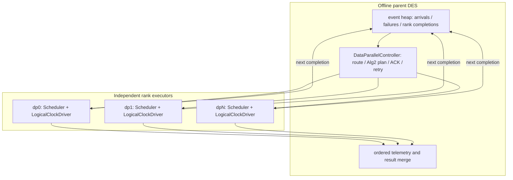

# Offline / Logical-Clock Simulation Design

**Status (2026-08-04):** Implemented | bounded Qwen3-32B DP4/PP4/32K
online-vs-offline failure gates pass for AegisKV and no-backup

**Evidence boundary:** Gate-v2-passing offline results may be used for bounded
algorithm search.  They are SGLSim metadata/prediction evidence, not physical
GPU data-movement evidence.  The selected policy was checked with a small
online wall-clock replay; the preserved long v13 wall run is an anchor because it
predates common scheduler telemetry and is not itself a field-complete v2 gate.

## Context

**Main branch** uses **wall-clock only**: each scheduler step `sleep(predicted)` on a real timeline. This matches online serving fidelity (multi-DP drift, HTTP client latency, subprocess isolation).

**Offline / logical-clock** mode is an isolated driver layer: advance independent
per-DP simulated clocks from the same predicted durations and metadata effects,
without sleeping.  It is the fast path for calibrated trace replay, policy
search, and ablation.  The existing online wall-clock path remains the parity
reference and must keep its current behavior.

## Related plans

- [trace-calibration-design.md](trace-calibration-design.md) — Mode B shape-only comparison needs logical time series
- [communication-time-prediction-design.md](communication-time-prediction-design.md) — comm overlap bookkeeping unchanged per rank
- [cache-aware-scheduling-design.md](cache-aware-scheduling-design.md) — DP load reports from all ranks

## Goal

Provide a **fast, metadata-only DES** path that:

1. Keeps **SGLang scheduling semantics** (prefill-first, continuous batching, HiCache metadata) identical to wall-clock main
2. Replaces GPU forward with **predicted duration** and advances **logical time** instead of `time.sleep`
3. Supports **streaming arrival** injection via a logical `created_time` queue (jump to next arrival when idle)
4. Keeps one logical clock per DP rank and uses a parent discrete-event
   coordinator only for request/failure injection, causality, and result merge
5. Reuses the same AegisKV Slack, placement, alpha/beta, KV metadata, ACK,
   failure/recovery, and retry-route implementations in online and offline modes

## Non-goals

- Replacing main wall-clock path or re-adding legacy dual-mode time CLI on main without an explicit product decision
- Bit-identical replay with real SGLang wall timestamps (compare **normalized shapes**, not absolute seconds)
- Strict per-step cross-DP max synchronization or a single global rank clock
- Reimplementing AegisKV policy/failure semantics in a second offline-only code path

## Reference implementations

| Source | Clock model | Lesson for SGLSim |
|--------|-------------|-------------------|
| sglang-simulator (`sglang/tools/sglang-simulator/build/lib`) | Process-local `_global_clock`, future-arrival heap, batch-result advancement, **no cross-process sync** | Independent rank clocks and idle jumps are the baseline; its simplified failure manager is not reused |
| Vidur / Opal-sim | Single-process DES | Fast but no multi-subprocess fidelity |
| Previous SGLSim prototype | `SimGlobalClock` (`mp.Value`) + `max(shared, rank_local)` on every step | **Known bug:** max-sync over-couples DP ranks, collapses per-request latency variance |

## Implemented architecture



### Time advancement (per rank)

Mirror sglang-simulator batch-driven advance:

1. **Batch prepared:** preserve the pinned SGLang order: receive/admit,
   `get_next_batch_to_run`, metadata allocation, then `run_batch` prediction.
2. **Rank completion scheduled:** feed the existing `compute_pipeline_sleep_s`
   stages to the logical driver.  The driver advances/schedules; it never sleeps.
3. **Batch completed:** call the existing `process_batch_result`, HiCache event
   consumption, backup ACKs, and request output/cache side effects.
4. **Idle with future local work:** jump only that rank to its next relevant
   request/failure event.  Do not advance another rank.
5. **Response time:** use the completing rank's logical timestamp.

Wall-clock Pipeline v2 bookkeeping (`compute_pipeline_sleep_s`) remains shared.
`ForwardSlot` CPU-overflow is wall-only: offline records zero CPU-overflow because
host scheduling jitter is intentionally outside the logical model.

### Cross-rank coordination (`dp_size > 1`)

Every rank owns a monotonic `_rank_clock`.  The parent min-heap orders externally
visible events by `(timestamp, deterministic_sequence)`.  A rank may not complete
a batch before its scheduled completion event, but another rank may run and
finish earlier.  Global makespan is `max(rank_last_event_time)`, not a clock
pushed back into workers.

The old `SimGlobalClock` behavior (`rank = max(shared, rank)` every step) is
forbidden: it over-couples independent DPs and collapses latency variance.

### Driver boundary

The public online server remains wall-only and unchanged.  Offline replay is a
separate parent driver (`AegisKV.demo.run_offline_wct`) over
`OfflineSchedulerCluster`; it does not add a logical-clock branch to
`launch_server` or revive `SimGlobalClock`.

### Parent integration

| Component | Wall (main) | Logical (future) |
|-----------|-------------|------------------|
| Driver | `WallClockDriver`: current `time.time/sleep/ForwardSlot` behavior | `LogicalClockDriver` per rank: monotonic now/advance, no sleep |
| Engine/workload | HTTP + async closed-loop clients + scheduler subprocesses | Parent DES + common request/route/failure builders |
| `TokenizerManager` | Current tokenize and wall arrival stamps | Pre-tokenized payload injected at logical arrival |
| `Scheduler.run_batch` | predict only | same |
| Scheduler advance | driver computes shared Pipeline v2 stages and sleeps | driver computes the same stages and schedules/advances rank time |
| `process_batch_result` | current cache/output/HiCache side effects | same function, using rank logical response time |
| AegisKV clocks | current wall/monotonic providers | injected parent/rank logical time provider |
| Metrics duration | wall timestamps | max per-rank last-event timestamp |
| Controller/scheduler transport | current IPC queues | causal requests, runtime commands, ACK/control events, and detokenizer messages returned synchronously with each parent-ordered rank event |

### Multi-DP causal transport and stats merge

The controller still executes the shared routing, placement, ledger, lineage,
ACK, failure, and retry logic.  Its selected request and rank-control commands
are captured by the offline parent and passed in the next causal worker command.
Each worker returns Aegis events and detokenizer messages in that same response.
This avoids `multiprocessing.Queue` feeder-thread races that could otherwise let
the parent pop a future failure before a just-dispatched request became visible.
No rank clock is advanced by another rank's transport delay.

### Scheduler snapshots (P2)

Push `SchedulerSnapshot(dp_rank, t, num_waiting, num_running, …)` to a queue for calibration and global queue-depth charts. See [trace-calibration-design.md](trace-calibration-design.md) schema.

## Read-only alignment audit (2026-08-04)

### Pinned SGLang scheduling semantics

Authoritative source:
`/home/comp/zhanzhao/sglang/python/sglang/srt/managers/scheduler.py`.

- `event_loop_normal`: receive/process requests, choose the next batch, run it,
  then process its result with the same `last_batch` lifecycle.
- `event_loop_overlap`: receive, choose the current batch, drain the previous
  result at the same control-flow points, run/enqueue the current result, and
  retain `last_batch` semantics.
- `get_next_batch_to_run`: prefill-first admission; a completed prefill merges
  into the persistent running batch; decode uses the normal update path.

Offline must not introduce a different admission rule, a global rank barrier,
or an extra event-loop gate.  The implementation seam is time advancement and
external event driving, not scheduler policy.

### Pinned sglang-simulator logical-time behavior

Audited source:
`/home/comp/zhanzhao/sglang/tools/sglang-simulator/build/lib/sglang_simulator/`.
The original `src` package is absent from this checkout; `build/lib` contains
the complete importable Python source used for the audit.

- `simulation/manager/state.py` stores `_global_clock` as process-local class
  state.  With one scheduler per process, it is effectively a per-rank clock.
- `simulation/sglang/scheduler.py` receives offline requests into a
  `(created_time, salt, request)` heap, admits arrivals at the local logical
  time, and jumps an idle clock to the next arrival.
- `run_batch` predicts forward time without sleeping.  Its wrapped
  `process_batch_result` advances logical time and accounts for HiCache
  load/backup overlap.
- There is no cross-process strict clock synchronization.

Useful ideas are the future-arrival heap, batch-driven advancement, and idle
jump.  Its hook-based implementation and simplified failure manager are not a
drop-in replacement for SGLSim's current Pipeline v2 and AegisKV semantics.

### Current SGLSim online path

Authoritative SGLSim sources:

- `python/sglsim/srt/managers/scheduler.py`: `run_batch` performs KV metadata
  allocation and forward prediction; `_advance_wall_clock_step` sleeps once;
  `_response_time_after_batch` consumes HiCache and backup events;
  `process_batch_result` applies request/cache/output side effects.
- `python/sglsim/srt/simulation/pipeline_accounting.py`: overlap ON exposes
  forward plus wall-only CPU overflow; overlap OFF serializes visible H2D with
  forward while D2H remains copy-engine-overlapped.
- `python/sglsim/srt/managers/data_parallel_controller.py`: routing, shared
  Alg2 backup planning/ACK, failure state, and retry-rank selection.
- `python/sglsim/srt/managers/aegis_l1_l2.py`: rank-local backup state and
  Alg3 alpha/beta windows.

The current online loop, HTTP path, subprocess topology, and streaming mode
remain unchanged.  Raw wall-time dependencies in scheduler restoration,
controller event timestamps, Alg3 windows, and radix-cache LRU must receive
explicit time providers before formal offline replay.  Offline must call the
same policy and metadata code, not serialize equivalent-looking copies.

## Online-vs-offline accuracy gate

### Paired-run inputs

Every calibration pair must record and hash the same:

- server/model configuration, including Qwen3-32B, DP=4, PP=4, and 32K context;
- pre-tokenized agentic trace and closed-loop dependency graph;
- random seed and deterministic event tie-break rule;
- request route plan and retry route plan;
- failure manifest, victim request IDs, outage durations, and recovery model;
- AegisKV algorithm and cache/placement configuration.

Run a small deterministic smoke pair first.  Only after it passes should the
formal configuration be replayed against preserved wall-clock artifacts.

### Required common telemetry

Both modes export the same machine-readable schemas:

- workflow and request WCT, TTFT, per-token/ITL or service-time samples;
- mean, p50, p90, p99, and makespan;
- per-DP waiting/running depth snapshots and completion sequence;
- primary and retry route decisions;
- cache load/eviction, backup plan/commit/ACK, retry, failure, and recovery
  events, including restored/recomputed token counts;
- per-batch predicted forward, H2D, pending D2H, visible communication,
  Pipeline v2 base duration, wall-only CPU overflow, and response timestamp.

### Gate v2 thresholds

These thresholds are deliberately explicit but provisional.  Smoke evidence may
tighten them; loosening requires a written causal explanation and a new gate
version.

| Class | Initial acceptance |
|---|---|
| Structural invariants | Exact request/workflow counts and terminal statuses |
| Routing/failure semantics | Exact primary routes, victim IDs, retry targets, failure-event order, and recovery actions |
| KV/Aegis side effects | Exact event counts and restored/recomputed token totals for deterministic smoke; formal run permits only explained cache-tie differences |
| Forward accounting | Per-request/batch predicted-forward totals within 1%; aggregate H2D/D2H accounting within 5% |
| WCT/makespan | mean/p50/p90/p99 and makespan within 10% |
| TTFT/ITL/service time | available percentile metrics within 10% |
| Per-DP completion order | Spearman rank correlation at least 0.99, excluding documented timestamp ties |
| Queue-depth shape | active-batch correlation at least 0.95 and MAE at most 1 request; for sparse depth 0/1 same-timestamp sibling ties, MAE at most 0.15 active steps |

No bit-identical requirement applies to absolute timestamps, OS/process jitter,
HTTP/tokenizer overhead, wall-only CPU overflow, or events whose timestamps are
tied within the configured deterministic epsilon.  These exclusions do not
waive semantic mismatches in routing, failure, ACK, recovery, or KV effects.

Offline output becomes formal AegisKV evidence only when the gate report records
`passed=true` for both smoke and formal pairs.  Candidate policies found offline
still require a small number of final online wall-clock replications.

### Current passing paired artifacts

All four artifacts use the formal Qwen3-32B DP4/PP4/32K server configuration,
the same first Weka/Real-CC workflow, 35 original requests, one frozen retry,
the same execution/retry route plan, and the same rank-3 failure manifest.  The
workload is deliberately scaled (`input_scale=0.008`, max input 1008, max output
16) so this is a bounded calibration pair, not the five-workflow result itself.

- AegisKV: `candidate-failure-online-aegiskv.json` vs
  `candidate-failure-offline-aegiskv-v3.json`, gate
  `candidate-failure-gate-aegiskv-v3.json`; WCT error 1.54%, makespan error
  2.43%, gate passed.
- No-backup: `candidate-failure-online-no_backup.json` vs
  `candidate-failure-offline-no_backup-v2.json`, gate
  `candidate-failure-gate-no_backup-v3.json`; WCT error 2.02%, makespan error
  1.94%, gate passed.

Both gates match exact request/route/failure/recovery semantics, backup/cache
event counts, TTFT/ITL/service distributions, and forward/communication
accounting.  They also require the same per-rank request sets and at least 0.99
request-weighted completion-order Spearman correlation.  The no-backup queue
boundary is one same-timestamp sibling ordering: depth never exceeds one and
the active-step MAE is 0.134, below the explicit 0.15 sparse threshold.

### Gate-passed five-workflow search

After the bounded current-source gates passed, the independent-clock driver was
used for the frozen five-workflow Weka/Real-CC search: 465 original requests,
six retries, three matched failures, and identical primary/retry routes.  The
machine-readable index is
`formal-5wf-evidence-index-synchronous-v2.json`; the human-readable analysis is
`algorithm_search_summary.md`.  The selected candidate uses Algorithm 1 Slack,
Algorithm 2 lineage-aware mixed placement with a 0.3125 Host floor, and
Algorithm 3 smoothing 0.20.  It improves all five paired workflow WCTs versus
fair no-backup and reduces recomputation by 55,296 tokens (42.063%).  The CDF,
PDF, and raw samples use the `formal-5wf-wct-cdf-synchronous-v2` prefix.

## Phases

| Phase | Deliverables | Acceptance |
|-------|--------------|------------|
| **P0 — complete** | Injected wall/logical time driver and shared Pipeline v2 accounting | Online remains wall-only; logical steps do not sleep |
| **P1 — complete** | Parent event heap and independent DP rank executors | Earlier completion is visible; no strict max-sync |
| **P2 — complete** | Shared workload/failure builders and common telemetry export | Same trace/routes/manifest produce schema-complete pairs |
| **P3 — complete** | Smoke comparison and field-level gate | Gate v2 emits causal failures and passes bounded pairs |
| **P4 — complete for bounded calibration** | Qwen3-32B DP4/PP4/32K server-config failure calibration | Current AegisKV and no-backup pairs pass; full long v13 remains an anchor |
| **P5 — complete** | Offline AegisKV/no_backup/ablation/search + selected online replay | Both bounded online gates pass; five-workflow tier, Host-floor, and Algorithm 3 searches are indexed and reproducible |

## Risks and mitigations

| Risk | Mitigation |
|------|------------|
| Max-sync coupling (old `SimGlobalClock`) | Default independent rank clocks; document option B explicitly |
| Dual-mode branch explosion | Inject one driver interface; retain `WallClockDriver` as the default and keep policy code mode-agnostic |
| TTFT / chunked prefill timestamps | Keep `service_time_s` accumulation for partial prefill (port from legacy logical-clock path) |
| Parent processes a long rank step atomically | Split prepare/complete scheduling so another rank's earlier completion can be popped first |
| Clock drift in Alg3/LRU/controller | Inject the same rank/parent logical time provider into shared implementations |
| CI speed | Use logical mode for new deterministic unit tests; preserve wall-clock integration/synthesis coverage |

## Test commands

```bash
uv run --extra test pytest test/unit/srt/test_time_driver.py -q
uv run --extra test pytest test/unit/srt/test_offline_cluster.py -q
uv run --extra test pytest test/unit/srt/test_offline_accuracy_gate.py -q
uv run --extra test pytest test/unit/srt/test_offline_workflow.py -q
```

## Links

- sglang-simulator scheduler hooks: `/home/comp/zhanzhao/sglang/tools/sglang-simulator/`
- Main wall-clock path: `python/sglsim/srt/managers/scheduler.py` → `_advance_wall_clock_step`
- Pipeline accounting: `python/sglsim/srt/simulation/pipeline_accounting.py`
