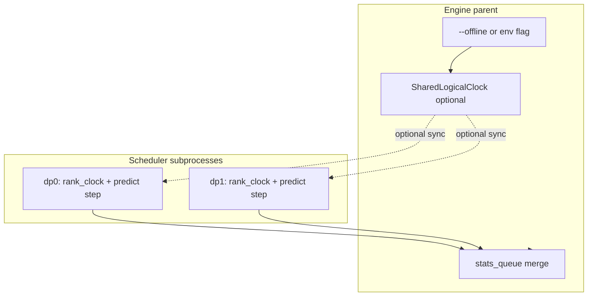

# Offline / Logical-Clock Simulation Design

**Status:** Draft | **Not implemented on main**

## Context

**Main branch** uses **wall-clock only**: each scheduler step `sleep(predicted)` on a real timeline. This matches online serving fidelity (multi-DP drift, HTTP client latency, subprocess isolation).

**Offline / logical-clock** mode is a **future optional layer**: advance a simulated time counter from predicted durations **without sleeping**, for fast trace replay, calibration shape checks, and offline what-if experiments. It is **not** on main today; this document records how to design it when reintroduced (separate branch, feature flag, or package extra).

## Related plans

- [trace-calibration-design.md](trace-calibration-design.md) — Mode B shape-only comparison needs logical time series
- [communication-time-prediction-design.md](communication-time-prediction-design.md) — comm overlap bookkeeping unchanged per rank
- [cache-aware-scheduling-design.md](cache-aware-scheduling-design.md) — DP load reports from all ranks

## Goal

Provide a **fast, metadata-only DES** path that:

1. Keeps **SGLang scheduling semantics** (prefill-first, continuous batching, HiCache metadata) identical to wall-clock main
2. Replaces GPU forward with **predicted duration** and advances **logical time** instead of `time.sleep`
3. Supports **streaming arrival** injection via a logical `created_time` queue (jump to next arrival when idle)
4. Optionally shares a **global logical clock** when `dp_size > 1` for unified metrics and queue snapshots

## Non-goals

- Replacing main wall-clock path or re-adding legacy dual-mode time CLI on main without an explicit product decision
- Bit-identical replay with real SGLang wall timestamps (compare **normalized shapes**, not absolute seconds)
- Single global scheduler for all DP ranks (keep per-rank subprocess topology)

## Reference implementations

| Source | Clock model | Lesson for SGLSim |
|--------|-------------|-------------------|
| sglang-simulator (`sglang/tools/sglang-simulator`) | Per-rank `_global_clock` class var, **no cross-process sync** | Independent rank clocks avoid artificial coupling; good baseline |
| Vidur / Opal-sim | Single-process DES | Fast but no multi-subprocess fidelity |
| Previous SGLSim prototype | `SimGlobalClock` (`mp.Value`) + `max(shared, rank_local)` on every step | **Known bug:** max-sync over-couples DP ranks, collapses per-request latency variance |

## Proposed architecture



### Time advancement (per rank)

Mirror sglang-simulator batch-driven advance:

1. **Batch ran:** `step_logical_time(hicache_load + forward + hicache_backup)` after `run_batch` predict
2. **Idle with future arrivals:** jump `logical_now` to next `created_time` (no empty spin steps)
3. **Response time:** `logical_now` at `process_batch_result` (+ backup remainder if not overlap-booked)

Wall-clock overlap bookkeeping (`compute_pipeline_sleep_s`, `ForwardSlot`) becomes **accounting only** in offline mode (no sleep).

### Shared clock (`dp_size > 1`) — design choices

| Option | Behavior | Trade-off |
|--------|----------|-----------|
| **A. Independent ranks** (sglang-simulator) | Each rank owns `_rank_clock`; metrics `duration = max(rid.last_event_time)` | Faithful parallelism; no unified timeline |
| **B. Loose sync** | Parent `Value` updated only on **batch completion** per rank: `shared = max(shared, rank_local)` | Unified duration; less coupling than per-micro-step max |
| **C. Strict max-sync** (old prototype) | Every `step_rank_clock` pushes `max(shared, rank)` | Simple but **over-couples** ranks — avoid as default |

**Recommendation:** default **A** for fidelity; optional **B** behind `global_clock_sync: true` for calibration export only.

### CLI / config sketch

```json
{
  "simulation": {
    "time_mode": "wall",
    "global_clock_sync": false
  }
}
```

| Field | Values | Notes |
|-------|--------|-------|
| `time_mode` | `"wall"` \| `"logical"` | Main implements `"wall"` only today |
| `global_clock_sync` | bool | Only meaningful when `time_mode=logical` and `dp_size > 1` |

Implement as **one flag** (e.g. `--offline` or `SGLSIM_TIME_MODE=logical`), not revived legacy dual-mode naming.

### Parent integration

| Component | Wall (main) | Logical (future) |
|-----------|-------------|------------------|
| `Engine.launch_subprocesses` | No shared clock | Create optional `SharedLogicalClock` in `SimIpcRegistry` |
| `TokenizerManager` | `time.time()` tokenize stamp | `logical_now` or measured tokenize added to rank clock |
| `Scheduler.run_batch` | predict only | same |
| `Scheduler` advance | `_advance_wall_clock_step` → sleep | `_advance_logical_step` → `StateManager.step_rank_clock` |
| `calc_bench_metrics` duration | wall / max last_event | `shared_clock.read()` or max `last_event_time` per option A/B |
| `stats_queue` | optional | **Required** for parent merge when `dp > 1` |

### Multi-DP stats merge (P1 dependency)

Logical mode needs the same parent-side merge as trace calibration:

- Child: `stats_queue.put((rid, RequestStats))` on completion
- Parent drain thread: merge into `REQUEST_STATS` (extend detokenizer drain or dedicated thread)
- `Engine._cache_metrics()` must aggregate per-rank signals when `dp_size > 1`

### Scheduler snapshots (P2)

Push `SchedulerSnapshot(dp_rank, t, num_waiting, num_running, …)` to a queue for calibration and global queue-depth charts. See [trace-calibration-design.md](trace-calibration-design.md) schema.

## Phases

| Phase | Deliverables | Acceptance |
|-------|--------------|------------|
| **P0** | `time_mode=logical`, `dp=1`, no shared clock | Unit test: N decode steps → `logical_now == sum(predicted)`; no `time.sleep` in hot path |
| **P1** | `stats_queue` merge, optional shared clock B | `test_multi_dp_*` metrics from parent; duration monotonic |
| **P2** | Snapshot export + benchmark hook | `compare_traces` Mode B queue shape gate |
| **P3** | Optional lockstep co-step driver | Only if trace replay requires deterministic cross-rank ordering |

## Risks and mitigations

| Risk | Mitigation |
|------|------------|
| Max-sync coupling (old `SimGlobalClock`) | Default independent rank clocks; document option B explicitly |
| Dual-mode branch explosion on main | Separate module `sglsim.srt.simulation.logical_clock` or feature branch; no time-mode branches in scheduler hot path on main |
| TTFT / chunked prefill timestamps | Keep `service_time_s` accumulation for partial prefill (port from legacy logical-clock path) |
| CI speed | Logical mode becomes default for unit tests; wall-clock stays integration / synthesis benchmark |

## Test commands (when implemented)

```bash
uv run --extra test pytest test/unit/srt/test_logical_clock_monotonic.py -q
uv run --extra test pytest test/unit/srt/test_multi_dp_logical_clocks.py -q
```

## Links

- sglang-simulator scheduler hooks: `/home/comp/zhanzhao/sglang/tools/sglang-simulator/`
- Main wall-clock path: `python/sglsim/srt/managers/scheduler.py` → `_advance_wall_clock_step`
- Pipeline accounting: `python/sglsim/srt/simulation/pipeline_accounting.py`
