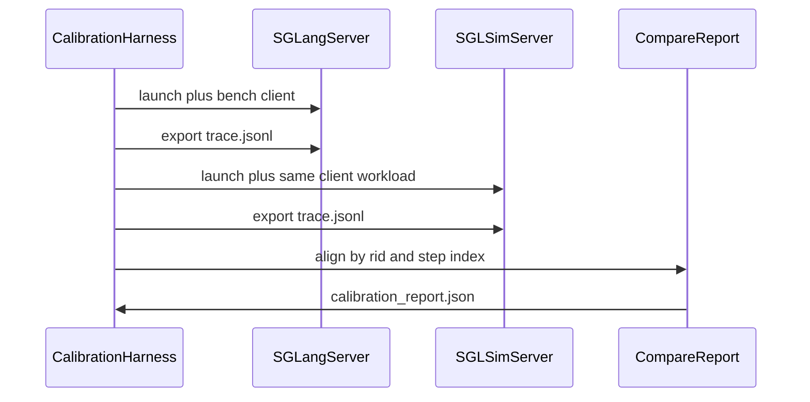

# Trace Calibration Design

**Status:** Draft | **Phase:** P0 not started

## Related plans

- [cache-aware-scheduling-design.md](cache-aware-scheduling-design.md)
- [offline-simulate-design.md](offline-simulate-design.md) — logical-clock Mode B (future)
- [communication-time-prediction-design.md](communication-time-prediction-design.md)

## Goal

Under the same workload and simulator JSON (except optional `predictor` scale factors), compare **real SGLang** (`/home/comp/zhanzhao/sglang` or user-provided install) with **SGLSim** on:

- TTFT / TPOT / ITL and end-to-end latency
- **Queue length time series** (`#queue-req` and related scheduler signals)
- Optional prefix-cache reuse ratio

Produce a machine-readable pass/fail report (`calibration_report.json`) plus a human-readable diff, not only unit-test semantic checks.

## Non-goals

- Importing `sglang` inside `python/sglsim/srt/` (forbidden by [test/unit/core/test_import_boundaries.py](../../test/unit/core/test_import_boundaries.py))
- Calibrating GPU kernel correctness or logits
- Automatic tuning of scheduling policy (order mismatches belong to cache-aware / DP plans)
- Full OpenAI API or multimodal parity

## Current state

| Area | SGLSim today | Gap |
|------|----------------|-----|
| Per-request latency | [RequestStats](../../python/sglsim/srt/simulation/types.py), [bench_metrics.py](../../python/sglsim/srt/observability/bench_metrics.py) | No export schema; DP subprocess stats not merged in parent ([engine.py](../../python/sglsim/srt/entrypoints/engine.py) ignores `stats_queue`) |
| Queue depth | Log lines in [scheduler_metrics_mixin.py](../../python/sglsim/srt/observability/scheduler_metrics_mixin.py) (`#queue-req`) | No structured time series |
| Benchmark harness | [benchmark/synthesis_requests/](../../benchmark/synthesis_requests/) | No SGLang side-by-side runner |
| SGLang reference | Scheduler logs in `sglang.srt.managers.scheduler` | No parser in repo |

## Target behavior

1. **Same client workload** drives both backends (reuse `benchmark/synthesis_requests/client.py` request definitions).
2. **Config mapping** documents how `benchmark/synthesis_requests/config/*/server.json` maps to SGLang `launch_server` flags (model, dp/tp, cache, policy).
3. **Wall-clock comparison:** SGLang wall clock vs SGLSim predicted-latency sleep on the same real timeline.
4. **Scale factors** (`predictor.prefill_scale_factor`, `decode_scale_factor`, `forward_scale`) may be adjusted only to fix systematic latency bias; they must not mask scheduling-order bugs.

## Architecture



### Package layout (to implement)

```text
benchmark/calibration/
  __init__.py
  schema.py              # TraceRun, RequestSeries, SchedulerSnapshot
  export_sglsim.py       # collect from Engine / HTTP / logs
  export_sglang.py       # subprocess: launch sglang, parse logs (no srt import)
  compare_traces.py      # CLI entry
  calibration_thresholds.json
  README.md
```

SGLang collection runs in a **subprocess or standalone script** outside `sglsim.srt`.

## Trace schema

### `run_meta`

| Field | Type | Description |
|-------|------|-------------|
| `backend` | `"sglang"` \| `"sglsim"` | Source |
| `model_path` | string | Model id |
| `dp_size`, `tp_size`, `pp_size` | int | Parallelism |
| `schedule_policy` | string | e.g. `fcfs`, `lpm` |
| `clock_mode` | `"wall"` | Wall-clock trace only |
| `git_sha_sglang` | string | Optional upstream rev |
| `sglsim_version` | string | Package version |
| `sim_config_path` | string | Materialized JSON path |

### `request_series` (per rid)

| Field | Type | Description |
|-------|------|-------------|
| `rid` | string | Request id |
| `input_length`, `output_length` | int | Token counts |
| `gen_token_latencies` | float[] | Seconds per token (TTFT = [0]) |
| `queue_start`, `queue_end` | float | Logical or wall time |
| `final_reused_tokens` | int | Prefix cache hits |
| `prefill_steps`, `decode_steps` | int | Optional scheduler steps |

### `scheduler_series` (repeated samples)

| Field | Type | Description |
|-------|------|-------------|
| `t` | float | Sample time (global or per-rank) |
| `dp_rank` | int | Data-parallel rank |
| `num_running` | int | Running batch size |
| `num_waiting` | int | Waiting queue length |
| `num_logical_tokens` | int | Sum of req lengths in running batch |

**SGLSim:** add periodic snapshot in scheduler `event_loop_step` (every N iterations or on prefill/decode log) to avoid fragile log parsing.

**SGLang:** parse `#queue-req=` from server log; optional Phase 2 poll `/get_load` when GPU available.

## Comparison rules

Config file: `benchmark/calibration/calibration_thresholds.json`

| Metric | Default gate | Notes |
|--------|--------------|-------|
| TTFT p50 / p99 | relative error <= 15% | Per-metric override |
| TPOT p50 / p99 | relative error <= 15% | |
| ITL p99 | relative error <= 20% | |
| `num_waiting` series | DTW or step-aligned L1 | Mode B: normalize by max queue |
| Scheduling order | exact rid order in first K prefill batches | Optional strict mode |

Output:

- `calibration_report.json`: `passed`, per-metric deltas, worst offenders
- `calibration_report.md`: tables for humans
- Exit code 0 / 1 for CI

## Config mapping (SGLang vs simulator JSON)

| Simulator JSON | SGLang flag / concept |
|----------------|----------------------|
| `scheduler.dp_size` | `--dp-size` |
| `scheduler.tp_size` | `--tp-size` |
| `scheduler.schedule_policy` | `--schedule-policy` |
| `cache.page_size`, `hicache_*` | `--page-size`, hierarchical cache args |
| `predictor.*` | N/A (SGLSim only); use scale only on sim side |
| `platform.accelerator.name` | Hardware for AIConfigurator / tables |

Document full mapping in `benchmark/calibration/README.md` when P1 lands.

## Phases

| Phase | Deliverables | Acceptance | Dependencies |
|-------|--------------|------------|--------------|
| **P0** | `schema.py`, SGLSim export stub, compare stub with synthetic JSON | `dp=1`, FCFS, mock-model: two JSON files + report | None |
| **P1** | `export_sglang.py`, golden workload (8 reqs), manual README | One local run produces report | GPU optional for real model |
| **P2** | Scheduler snapshots, `dp=2`, policy matrix (`fcfs`, `lpm`) | Integration test; `@pytest.mark.sglang` skip if no install | DP stats merge in parent `Engine` |
| **P3** | `calibration_thresholds.json`, CI docs, link from [docs/README.md](../README.md) | Smoke in CI (skip without sglang); nightly doc | P1, P2 |

## Test commands

```bash
# After P0
uv run --extra test pytest test/unit -k calibration -q

# After P1 (local, requires SGLang install)
uv run --extra benchmark python -m benchmark.calibration.compare_traces \
  --config benchmark/synthesis_requests/config/synthesis-a100-smoke \
  --sglang-root /home/comp/zhanzhao/sglang

# Full suite
uv run --extra test pytest test/unit test/integration -q
```

## Risks

| Risk | Mitigation |
|------|------------|
| SGLang not installed in CI | `@pytest.mark.sglang`, document manual path |
| DP stats only in child process | Block P2 on parent stats merge from scheduler subprocesses |
| Log format drift in upstream | Prefer structured snapshots on SGLSim; version-pin sglang SHA in `run_meta` |

## Links

- [sglsim-srt-contract.md](../sglsim-srt-contract.md)
- [reference/sglang_notes.md](../../reference/sglang_notes.md)
- [benchmark/synthesis_requests/](../../benchmark/synthesis_requests/)
